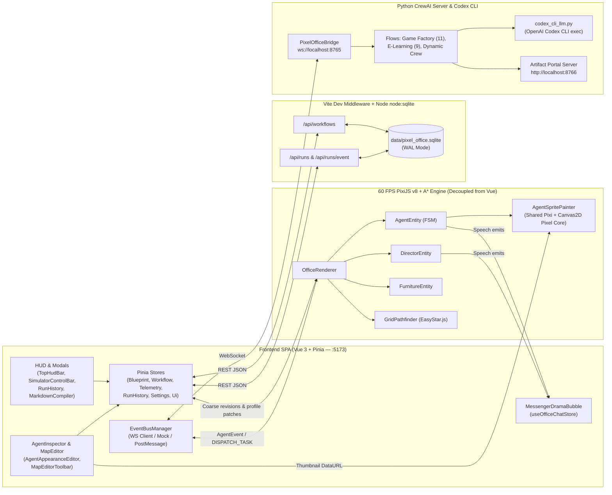

# 🏗️ Kiến Trúc Hệ Thống — Pixel Agent Office

Tài liệu này mô tả thiết kế tổng thể, luồng dữ liệu thời gian thực và tầng lưu trữ SQLite của **Pixel Agent Office**.

---

## 1. Sơ Đồ Kiến Trúc Tổng Quan

---

## 2. Nguyên Tắc Tách Biệt Render 60 FPS (`Decoupled Engine`)

Để đảm bảo tốc độ khung hình **60 FPS** ổn định khi nhiều Agent di chuyển, gõ phím, bắn gói tin và trò chuyện cùng lúc:

- **Vòng lặp Ticker độc lập**: Toàn bộ thực thể đồ họa ([OfficeRenderer.ts](../src/engine/OfficeRenderer.ts), [AgentEntity.ts](../src/engine/AgentEntity.ts), [DirectorEntity.ts](../src/engine/DirectorEntity.ts), [FurnitureEntity.ts](../src/engine/FurnitureEntity.ts)) nằm trong thư mục `src/engine/` và tự cập nhật trên PixiJS ticker, **không đọc/ghi reactive refs của Vue ở mỗi frame**.
- **Giao tiếp Vue ↔ PixiJS dạng thô (`Coarse Watchers`)**: [PixelOfficeCanvas.vue](../src/components/canvas/PixelOfficeCanvas.vue) chỉ đẩy thay đổi sang PixiJS ở các mốc sự kiện rõ ràng:
  1. `blueprintStore.revision` thay đổi → Tải lại bản đồ (`renderer.loadBlueprint(...)`) khi đổi Workflow, compile Markdown hoặc sửa bố cục nội thất.
  2. `blueprintStore.agentPatchRevision` thay đổi → Gọi `renderer.updateAgentAppearance(...)` để **đổi tên, đổi avatar hoặc đổi màu tại chỗ (`in-place`)** thông qua `AgentEntity.updateProfile(...)` mà **không reset vị trí nhân vật**.
  3. `AgentEvent` tới từ `EventBusManager` → Đẩy vào hàng đợi riêng của từng Agent (`AgentEntity.enqueueEvent(...)`).
- **Đồng bộ chiều ngược lại có điều tiết (`Throttled`)**: Engine chỉ báo state thô (`IDLE`, `MOVING`, `WORKING`, `TOOL_CALL`, `HANDOFF`, `COMPLETE`, `ERROR`) về `useTelemetryStore` (Ring Buffer tối đa 200 log/phiên, cắt payload quá 10 KB) và `useOfficeChatStore` cho bong bóng Drama.

---

## 3. Lõi Vẽ Pixel Dùng Chung ([AgentSpritePainter.ts](../src/engine/graphics/AgentSpritePainter.ts))

Để **PixiJS Canvas** và **Ảnh Thumbnail trong Avatar Picker UI** luôn hiển thị khớp 100% cùng một nhân vật mà không lặp lại code vẽ pixel:
- Hàm `paintProceduralAgent(...)` nhận một giao diện trừu tượng `PixelRectTarget` (`{ rect(x, y, w, h, color, alpha?) }`).
- **Nhánh PixiJS** (`drawAgentToPixiGraphics` được gọi bởi [ProceduralSprites.ts](../src/engine/graphics/ProceduralSprites.ts)): Chuyển tọa độ sang `g.rect(x + 16, y + 20, w, h).fill(...)`.
- **Nhánh HTML5 Canvas2D** (`renderAgentAvatarToDataUrl`): Render 48×48px lên offscreen `<canvas>` và cache `data:image/png;base64,...` trong `Map` theo khóa `${avatarPreset}__${colorHex}` để grid 56 avatar phản hồi tức thì.

---

## 4. Trình Biên Dịch Markdown-to-Office 2 Giai Đoạn (`src/services/compiler/`)

Khi người dùng nhập mô tả quy trình (Markdown, sơ đồ ASCII, hoặc ngôn ngữ tự nhiên), hệ thống chạy qua pipeline **2 giai đoạn tách biệt**:

1. **Giai đoạn 1 — Trích xuất Topology ngữ nghĩa ([llmTopologyExtractor.ts](../src/services/compiler/llmTopologyExtractor.ts))**:
   - Cho phép chọn **Google Gemini** (`@google/genai` với `responseSchema`), **OpenAI API**, hoặc **Offline Deterministic Parser** (`parseMarkdownDeterministically`).
   - Đầu ra chỉ chứa thông tin ngữ nghĩa (`Stage1SemanticTopology`): danh sách phòng (`WORK`, `APPROVAL`, `IDLE`), nhân sự (`id`, `name`, `role`, `color`, `avatar_sprite` lấy ngẫu nhiên không trùng từ [agentAvatarCatalog.ts](../src/data/agentAvatarCatalog.ts)) và cạnh `edges`. **Không sinh tọa độ `(x, y)` ở bước này.**
2. **Giai đoạn 2 — Bố trí Lưới Tất Định ([deterministicLayoutEngine.ts](../src/services/compiler/deterministicLayoutEngine.ts))**:
   - Tính toán kích thước bản đồ (`grid_cols x grid_rows`), phân vùng phòng ban (kèm phòng `DIRECTOR` riêng cho Giám đốc), đặt bàn làm việc `DESK_PC` đảm bảo khoảng cách hành lang tối thiểu 1 ô và trang trí tự động ~45 món nội thất sinh động (bao gồm `PS5_PES_STATION`, khu sinh thái cỡ lớn, thú cưng/robot di chuyển).
   - Kết quả được `GridPathfinder` ([GridPathfinder.ts](../src/engine/GridPathfinder.ts)) kiểm chứng khả năng đi lại 100% bằng A*.

---

## 5. Lưu Trữ SQLite & REST API (`vite.config.ts` & `server/sqliteRunHistoryPlugin.ts`)

Ứng dụng tận dụng module **`node:sqlite` (`DatabaseSync`)** tích hợp trong Node.js (v22.14+), ghi trực tiếp vào tệp **`data/pixel_office.sqlite`** ở chế độ `WAL` (`busy_timeout = 5000`).

### Các bảng dữ liệu chính

| Bảng SQLite | Vai trò | Cột quan trọng |
| :--- | :--- | :--- |
| **`workflows`** | Lưu toàn bộ cấu hình phòng ban, bản đồ 2D, danh sách Agent (cả tên/avatar đã sửa), nội thất và tài liệu tích hợp | `id`, `name`, `description`, `crew_endpoint_url`, `raw_requirement`, `blueprint_json`, `steps_json`, `integration_doc_md`, `created_at` |
| **`crew_runs`** | Lưu lịch sử từng phiên chạy CrewAI (`RunHistoryModal`) | `id`, `workflow_id`, `workflow_name`, `endpoint_url`, `prompt`, `attached_file_name`, `status`, `started_at`, `finished_at`, `elapsed_seconds`, `llm_engine`, `total_tokens`, `qa_score`, `qa_decision`, `portal_url`, `zip_url`, `result_json`, `error_message` |
| **`crew_run_events`** | Lưu nhật ký từng bước (`AGENT_START`, `TOOL_CALL`, `HANDOFF`, `COMPLETE`, `ERROR`) của mỗi phiên chạy | `id`, `run_id`, `seq`, `event_id`, `timestamp`, `event_type`, `agent_id`, `agent_name`, `target_agent_id`, `status_text`, `icon`, `tokens_used`, `payload_json` |

### Endpoints API nội bộ (Vite Middleware)

- **`GET /api/workflows`**: Tải toàn bộ workflows từ SQLite (`ORDER BY created_at ASC`).
- **`POST /api/workflows`**: Upsert một workflow (`{ workflow }`) hoặc danh sách (`{ workflows }`) — được gọi tự động khi tạo crew mới, sửa Map Editor, hoặc đổi tên/avatar nhân viên.
- **`DELETE /api/workflows?id=<id>`**: Xóa workflow theo `id`.
- **`GET /api/runs?limit=100&workflow_id=...`**: Lấy danh sách các phiên chạy mới nhất kèm tổng số sự kiện `event_count`.
- **`GET /api/runs?id=<run_id>`**: Lấy chi tiết một phiên chạy kèm toàn bộ danh sách `events`.
- **`POST /api/runs`**: Tạo mới hoặc cập nhật trạng thái phiên chạy (`running` → `completed` / `error`), kết quả JSON, điểm QA và URL sản phẩm.
- **`POST /api/runs/event`**: Ghi từng sự kiện của Agent trong phiên chạy và tự động cộng dồn `total_tokens` vào `crew_runs`.
- **`DELETE /api/runs?id=<run_id>`** hoặc **`DELETE /api/runs?all=1`**: Xóa một phiên chạy hoặc dọn sạch toàn bộ lịch sử.

> **Lưu trữ phía trình duyệt bổ sung**: Custom PNG sprite sheets do người dùng tải lên từ máy được lưu trong IndexedDB ([indexedDbAssets.ts](../src/services/storage/indexedDbAssets.ts)); API Keys (Gemini/OpenAI), tốc độ mô phỏng và bản sao dự phòng local lưu ở `localStorage` ([localConfig.ts](../src/services/storage/localConfig.ts)).
