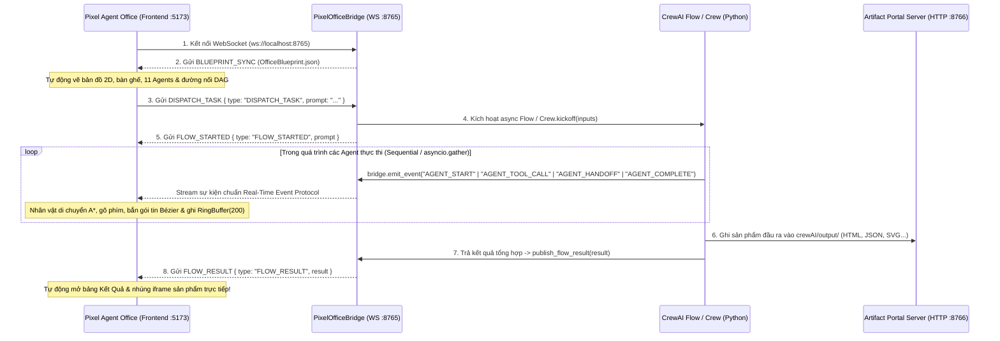

# CHUẨN HÓA KẾT NỐI: CREWAI ↔ PIXEL AGENT OFFICE (`v1.0.0`)

Tài liệu này định nghĩa chuẩn giao tiếp hai chiều (Bidirectional Integration Standard) giữa các hệ thống **CrewAI / CrewAI Flows (Python)** và ứng dụng trực quan hóa **Pixel Agent Office (Pure Frontend)**.

Với chuẩn này, bạn có thể đẩy **bất kỳ Crew mới nào** vào thư mục `crewAI/flows/` để:
1. **Tự động dựng bản đồ văn phòng 2D (`BLUEPRINT_SYNC`)** đúng số lượng Agents, phòng ban (`WORK`, `APPROVAL`, `IDLE`) và đồ thị luồng công việc (`edges`) mà không cần vẽ tay tọa độ `(x, y)`.
2. **Giao việc trực tiếp từ giao diện Frontend (`DISPATCH_TASK`)** xuống CrewAI Backend.
3. **Stream trạng thái thời gian thực (`60 FPS`)** của từng Agent (`WORKING`, `TOOL_CALL`, `HANDOFF`, `COMPLETE`, `IDLE`) và **nhận kết quả đầu ra (`FLOW_RESULT`)** ngay trên Frontend.

---

## 1. Kiến Trúc Kết Nối Hai Chiều (Bidirectional Architecture)



---

## 2. Chuẩn Bản Tin Giao Tiếp Qua WebSocket (`ws://localhost:8765`)

### 2.1. Các Bản Tin Điều Khiển (Server ↔ Frontend Control Packets)

| Chiều | `type` | Cấu trúc JSON Payload | Ý nghĩa |
| :--- | :--- | :--- | :--- |
| **Server → UI** | `BLUEPRINT_SYNC` | `{ "type": "BLUEPRINT_SYNC", "blueprint": OfficeBlueprint }` | Tự động đồng bộ cấu trúc phòng ban, danh sách Agents, nội thất và đồ thị `edges` lên bản đồ 2D ngay khi kết nối. |
| **UI → Server** | `DISPATCH_TASK` | `{ "type": "DISPATCH_TASK", "prompt": "...", "options": { "step_delay": 0.85 } }` | Người dùng giao việc trực tiếp từ ô nhập Prompt trên Frontend xuống CrewAI. |
| **UI → Server** | `REQUEST_BLUEPRINT` | `{ "type": "REQUEST_BLUEPRINT" }` | Yêu cầu Server gửi lại `OfficeBlueprint.json` hiện hành. |
| **Server → UI** | `FLOW_STARTED` | `{ "type": "FLOW_STARTED", "prompt": "..." }` | Thông báo CrewAI đã bắt đầu chạy luồng công việc. |
| **Server → UI** | `FLOW_RESULT` | `{ "type": "FLOW_RESULT", "result": CrewAiFlowResult }` | Trả kết quả hoàn chỉnh (`portal_url`, `streams`, `master_blueprint`, `qr_svg`) để hiển thị ngay trên Frontend. |
| **Server → UI** | `FLOW_ERROR` | `{ "type": "FLOW_ERROR", "error": "..." }` | Thông báo lỗi nếu quá trình chạy CrewAI gặp sự cố. |

### 2.2. Bản Tin Sự Kiện Nhân Vật (Real-Time Agent Event Stream)

Mọi sự kiện hoạt động của Agent được phát qua `await bridge.emit_event(...)` đều tuân thủ chuẩn `AgentEvent`:

```json
{
  "event_id": "evt_1731600000_a1b2c3",
  "timestamp": 1731600000000,
  "event_type": "AGENT_START | AGENT_TOOL_CALL | AGENT_HANDOFF | AGENT_COMPLETE | AGENT_ERROR",
  "agent_id": "agent_pedagogy",
  "target_agent_id": "agent_creative",
  "metadata": {
    "status_text": "Chuyển giao Pedagogy Spec sang Creative Director...",
    "icon": "search | code | db | error | message | check",
    "input_payload": {},
    "output_payload": {},
    "tokens_used": 480,
    "duration_ms": 1200
  }
}
```

### 2.3. Bảng Ánh Xạ Lifecycle của CrewAI sang FSM của Pixel Agent Office

| Sự kiện trong CrewAI / CrewAI Flows | Gọi hàm trong `PixelOfficeBridge` | Hiệu ứng trên Pixel Agent Office (`60 FPS`) |
| :--- | :--- | :--- |
| Agent bắt đầu nhận Task (`@start` / `@listen` / `task_start`) | `await bridge.emit_event("AGENT_START", agent_id, status_text, input_payload=...)` | Nhân vật đi bộ theo A\* về bàn làm việc, ngồi đúng hướng `facing`, màn hình PC phát sáng, hiện bong bóng trạng thái (giữ tối thiểu `1200ms`). |
| Agent gọi Tool (`FileWriter`, `Playwright`, `SerperDevTool`...) | `await bridge.emit_event("AGENT_TOOL_CALL", agent_id, status_text, icon="code"\|"search"\|"db")` | Hiển thị huy hiệu công cụ (`search`, `code`, `db`, `error`) trên đầu nhân vật và cập nhật Inspector Drawer. |
| Chuyển giao dữ liệu giữa 2 Agents (Sequential hoặc `asyncio.gather` fan-out) | `await bridge.emit_event("AGENT_HANDOFF", from_id, status_text, target_agent_id=to_id, icon="message")` | Bắn gói tin phát sáng theo đường cong Bézier từ bàn nguồn sang bàn đích (hoặc đi bộ trực tiếp nếu khoảng cách `< 6 tiles`), làm sáng rực đường nối DAG trong God-View. |
| Agent hoàn thành Task (`task_callback` / kết thúc bước) | `await bridge.emit_event("AGENT_COMPLETE", agent_id, status_text, icon="check")` | Hiển thị dấu tích hoàn tất; sau `8000ms` không có sự kiện mới, nhân vật tự động đi bộ sang khu `IDLE` (máy pha cà phê, ghế sofa, hồ cá) và trò chuyện nếu đứng gần nhau `<= 2 tiles`. |

---

## 3. Hướng Dẫn Đẩy Một Crew Mới Vào Kiểm Thử (3 Bước)

Khi bạn muốn đẩy một Crew mới vào kiểm thử, chỉ cần tạo một file trong `crewAI/flows/` (dựa trên mẫu [custom_crew_template.py](../crewAI/flows/custom_crew_template.py)):

### Bước 1: Khai báo danh sách `AgentSpec` & `EdgeSpec` (Không cần tọa độ)
```python
from pixel_office_sdk import AgentSpec, EdgeSpec, build_office_blueprint

def get_my_new_crew_blueprint():
    agents = [
        AgentSpec(id="agent_researcher", name="Researcher", role="Thu thập dữ liệu", zone_id="zone_work", color="#38bdf8"),
        AgentSpec(id="agent_writer", name="Tech Writer", role="Viết tài liệu", zone_id="zone_work", color="#22c55e"),
        AgentSpec(id="agent_qa", name="QA Reviewer", role="Kiểm duyệt chất lượng", zone_id="zone_approval", color="#eab308"),
    ]
    edges = [
        EdgeSpec("agent_researcher", "agent_writer", "Raw Notes"),
        EdgeSpec("agent_writer", "agent_qa", "Draft Spec"),
    ]
    # Tự động tính toán lưới, chia phòng WORK/APPROVAL/IDLE và đặt bàn cách nhau >= 1 tile!
    return build_office_blueprint("MY NEW CREW PROJECT", agents, edges)
```

### Bước 2: Phát sự kiện trong hàm thực thi Crew / Flow
```python
async def run_my_new_crew(prompt: str, bridge: PixelOfficeBridge, output_dir: Path, options: dict):
    await bridge.emit_event("AGENT_START", "agent_researcher", f"Đang nghiên cứu: {prompt}")
    # ... gọi CrewAI hoặc LLM ...
    await bridge.emit_event("AGENT_HANDOFF", "agent_researcher", "Chuyển dữ liệu sang Writer", target_agent_id="agent_writer")
    await bridge.emit_event("AGENT_COMPLETE", "agent_researcher", "Hoàn tất nghiên cứu ✓")
    # ...
    return {
        "flow_name": "MY NEW CREW PROJECT",
        "prompt": prompt,
        "elapsed_seconds": 4.2,
        "portal_url": "http://localhost:8766/portal.html",
        "streams": [],
        "master_blueprint": {"output": "Nội dung kết quả..."},
        "qr_svg": ""
    }
```

### Bước 3: Đăng ký vào `crewAI/server.py`
Trong `crewAI/server.py`, trỏ `get_game_factory_blueprint` và `run_game_factory_flow` sang hàm của Crew mới. Ngay lập tức:
- Frontend (`http://localhost:5173/`) sẽ tự động nhận `BLUEPRINT_SYNC` và vẽ lại văn phòng mới.
- Bạn có thể bấm **"🚀 Giao Việc CrewAI"** trên thanh công cụ để giao việc và nhận kết quả trực tiếp!
