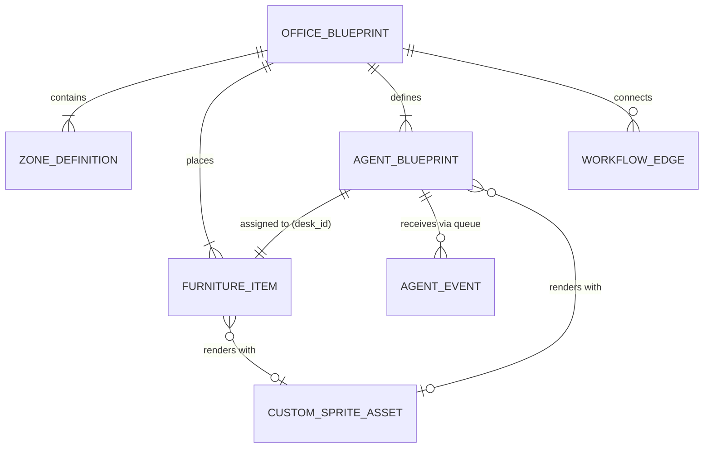

# Phase 1 Data Model & State Architecture: Pixel Agent Office

**Branch**: `001-pixel-agent-office` | **Date**: 2026-11-14 | **Spec**: [spec.md](./spec.md)

## 1. Core Domain Entities & TypeScript Interfaces

### 1.1 `OfficeBlueprint` (Static Spatial & Graph Topology)

```typescript
export type ZoneType = 'WORK' | 'APPROVAL' | 'IDLE';
export type Direction = 'UP' | 'DOWN' | 'LEFT' | 'RIGHT';
export type FurnitureType =
  | 'DESK_PC'
  | 'COFFEE_MACHINE'
  | 'SOFA'
  | 'PLANT'
  | 'AQUARIUM'
  | 'WHITEBOARD'
  | 'BOOKSHELF';

export interface BlueprintMeta {
  project_name: string;   // Non-empty string, max 120 chars
  grid_cols: number;      // Integer, min 12, max 64 (default 24)
  grid_rows: number;      // Integer, min 10, max 64 (default 16)
  tile_size: 32;          // Locked canonical base tile size (32x32px)
}

export interface ZoneDefinition {
  id: string;             // Unique identifier, e.g., "zone_work"
  name: string;           // Display label, e.g., "Khu Phát Triển"
  type: ZoneType;         // Determines floor palette & idle behavior
  rect: [number, number, number, number]; // [x, y, width, height] in grid tiles
}

export interface FurnitureItem {
  id: string;             // Unique identifier, e.g., "furn_desk_1"
  type: FurnitureType;
  x: number;              // Top-left grid column (0 <= x < grid_cols)
  y: number;              // Top-left grid row (0 <= y < grid_rows)
  footprint: [number, number];        // [width_tiles, height_tiles] — marks blocked cells
  interaction_point: [number, number]; // [ix, iy] — MUST be a walkable tile outside footprint
  facing: Direction;      // Direction agent faces when standing at interaction_point
  agent_id?: string;      // Optional owner agent ID (required for DESK_PC assigned to an agent)
  custom_asset_id?: string; // Optional reference to IndexedDB CustomSpriteAsset
}

export interface AgentBlueprint {
  id: string;             // Unique identifier, e.g., "agent_researcher"
  name: string;           // Display name, e.g., "Alice (Researcher)"
  role: string;           // Role description, e.g., "Thu thập & Tổng hợp dữ liệu"
  color: string;          // Hex color string (#RRGGBB) used for procedural avatar & DAG glow
  avatar_sprite: string;  // Preset procedural key or IndexedDB CustomSpriteAsset ID
  desk_id: string;        // Foreign key referencing FurnitureItem.id (type === 'DESK_PC')
}

export interface WorkflowEdge {
  from: string;           // Source AgentBlueprint.id
  to: string;             // Target AgentBlueprint.id
  label?: string;         // Optional edge label, e.g., "Raw Data"
}

export interface OfficeBlueprint {
  meta: BlueprintMeta;
  zones: ZoneDefinition[];
  furniture: FurnitureItem[];
  agents: AgentBlueprint[];
  edges: WorkflowEdge[];
}
```

**Validation Rules (`FR-003`, `FR-006`, `FR-015`)**:
1. Every `ZoneDefinition.rect` MUST lie within `[0, 0, meta.grid_cols, meta.grid_rows]` without overlapping another zone.
2. Every `FurnitureItem` footprint `[x..x+w-1, y..y+h-1]` MUST not overlap any other furniture footprint or wall boundary.
3. Every `FurnitureItem.interaction_point` `[ix, iy]` MUST be within grid bounds and MUST NOT fall inside any furniture footprint (`walkability[iy][ix] === 0`).
4. Every `AgentBlueprint.desk_id` MUST reference an existing `FurnitureItem` with `type === 'DESK_PC'`.

---

### 1.2 `AgentEvent` (Real-Time Telemetry Protocol)

```typescript
export type AgentEventType =
  | 'AGENT_START'
  | 'AGENT_TOOL_CALL'
  | 'AGENT_HANDOFF'
  | 'AGENT_COMPLETE'
  | 'AGENT_ERROR';

export type ToolIconType = 'search' | 'code' | 'db' | 'error' | 'message' | 'check';

export interface AgentEventMetadata {
  status_text?: string;                   // Overhead status bubble text (max 140 chars displayed)
  icon?: ToolIconType;                    // Overhead tool badge icon
  input_payload?: Record<string, unknown> | string;
  output_payload?: Record<string, unknown> | string;
  tokens_used?: number;                   // Non-negative integer
  duration_ms?: number;                   // Non-negative integer
}

export interface AgentEvent {
  event_id: string;                       // Unique ID, e.g., "evt_982341"
  timestamp: number;                      // Unix epoch (seconds or ms)
  event_type: AgentEventType;
  agent_id: string;                       // References AgentBlueprint.id
  target_agent_id?: string;               // Required when event_type === 'AGENT_HANDOFF'
  metadata: AgentEventMetadata;
}

export interface StoredTelemetryEvent extends AgentEvent {
  received_at_ms: number;
  input_truncated: boolean;
  output_truncated: boolean;
  input_preview: string;                  // Truncated to <= 10,240 bytes (10KB)
  output_preview: string;                 // Truncated to <= 10,240 bytes (10KB)
  full_payload_blob_key?: string;         // Optional IndexedDB/Blob reference for "Download Full JSON"
}
```

---

### 1.3 Runtime `AgentEntity` State & Finite State Machine (FSM)

```typescript
export type AgentFsmState =
  | 'IDLE'          // Standing/sitting at IDLE zone furniture or wandering in IDLE zone
  | 'MOVING'        // Traversing A* path towards target interaction_point
  | 'WORKING'       // At desk interaction_point, facing PC, typing animation + status bubble
  | 'TOOL_CALL'     // At desk interaction_point, overhead tool icon badge + pulsing ring
  | 'HANDOFF'       // Emitting Bézier packet (or walking if distance < 6 tiles) to target_agent_id
  | 'COMPLETE'      // Task finished at desk; 8000ms countdown running before returning to IDLE
  | 'ERROR';        // Red warning bubble + error icon badge at current position
```

#### FSM Transition Matrix

| Current State | Trigger / Condition | Next State | Visual & Spatial Action |
|---------------|---------------------|------------|-------------------------|
| `IDLE` | Dequeue `AGENT_START` or `AGENT_TOOL_CALL` | `MOVING` (if not at desk) or `WORKING`/`TOOL_CALL` | Compute A* path from current tile to assigned desk `interaction_point`. Clear chat bubble. |
| `MOVING` | Reach final A* waypoint `[ix, iy]` | Target state (`WORKING`, `TOOL_CALL`, `HANDOFF`, `IDLE`) | Snap to `[ix, iy]`, rotate sprite to `facing`, start `1200ms` minimum active state timer. |
| `WORKING` | `>= 1200ms` elapsed AND next event is `AGENT_TOOL_CALL` | `TOOL_CALL` | Keep PC screen lit, switch overhead bubble to tool icon badge (`search`, `code`, `db`, `error`). |
| `WORKING` / `TOOL_CALL` | `>= 1200ms` elapsed AND next event is `AGENT_HANDOFF` | `HANDOFF` | If Manhattan distance between desks `< 6 tiles`, walk to target desk; otherwise launch Bézier curve packet from Desk A to Desk B (`600ms` flight). |
| `WORKING` / `TOOL_CALL` / `HANDOFF` | `>= 1200ms` elapsed AND next event is `AGENT_COMPLETE` | `COMPLETE` | Show completion check badge, start `8000ms` inactivity timer. |
| `COMPLETE` | New `AGENT_START` arrives before `8000ms` | `WORKING` | Cancel inactivity timer, resume work at desk immediately. |
| `COMPLETE` | `8000ms` timer expires with empty queue | `MOVING` → `IDLE` | Reserve unoccupied `IDLE` zone furniture `interaction_point` (or walkable `IDLE` tile), compute A* path, walk to pantry/lounge. |
| `IDLE` | Another `IDLE` agent within Manhattan distance `<= 2 tiles` | `IDLE` (Chatting) | Display synchronized pixel speech bubbles above both agents for `3500ms`. |
| Any State | Dequeue `AGENT_ERROR` | `ERROR` | Display red pulsing warning triangle (`error` icon) and status text for `>= 1200ms`. |

---

### 1.4 `CustomSpriteAsset` (`IndexedDB` Schema)

- **Database Name**: `pixel_agent_office_db` (Version `1`)
- **Object Stores**:
  1. `sprite_assets` (keyPath: `id`):
     - `id: string` (e.g., `"sprite_agent_cyber_01"`)
     - `name: string`
     - `category: 'AGENT' | 'FURNITURE'`
     - `tile_width: 32`
     - `tile_height: 32`
     - `rows: 4 | 1` (`4` directional rows `Down, Left, Right, Up` for `AGENT`; `1` row for `FURNITURE`)
     - `frames_per_row: number` (default `3` or `4`)
     - `png_blob: Blob`
     - `created_at: number`
  2. `blueprint_snapshots` (keyPath: `id`):
     - Stores user-edited blueprints and AI-compiled blueprints so custom layouts survive browser restarts.

---

## 2. Entity Relationship Diagram


