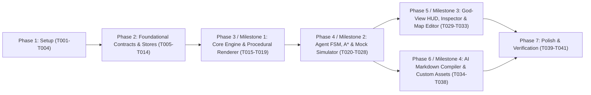

# Tasks: Pixel Agent Office — 2D Multi-Agent Visual Renderer & Simulator

**Input**: Design documents from `/specs/001-pixel-agent-office/` and `/design-system/pixel-agent-office/`

**Prerequisites**: [plan.md](./plan.md) (required), [spec.md](./spec.md) (required), [research.md](./research.md), [data-model.md](./data-model.md), [contracts/](./contracts/), [MASTER.md](../../design-system/pixel-agent-office/MASTER.md)

**Organization**: Tasks are grouped by foundational phases and User Stories (`US1`–`US4`, mapping directly to Execution Milestones 1–4) so each increment is independently buildable and verifiable at `60 FPS`.

## Format: `[ID] [P?] [Story] Description`

- **[P]**: Can run in parallel (different files, no dependencies on incomplete tasks)
- **[Story]**: Maps task to User Story (`[US1]`, `[US2]`, `[US3]`, `[US4]`)
- All tasks include exact target file paths and explicit data-model constraints

---

## Phase 1: Setup (Shared Infrastructure)

**Purpose**: Initialize Vue 3 + TypeScript + Pinia + Tailwind CSS + PixiJS v8 + EasyStar.js project scaffold and 3-layer design tokens.

- [X] T001 Initialize Vite + Vue 3 + TypeScript project configuration in `package.json`, `vite.config.ts`, and `tsconfig.json` with dependencies `vue@^3.5`, `pinia@^2.2`, `pixi.js@^8.0`, `easystarjs@^0.4.4`, `@google/genai`, `lucide-vue-next`, `tailwindcss`, and `vitest`
- [X] T002 [P] Configure Tailwind CSS with 3-layer design tokens (`--color-canvas-void: #020617`, `--color-background: #0F172A`, `--font-pixel`, `--font-mono`, `--font-sans`) in `tailwind.config.js` and `src/assets/styles/main.css` importing `assets/design-tokens.css`
- [X] T003 [P] Create pixel-art HUD utility styles (`image-rendering: pixelated`, crisp 1px slate borders, God-View glow keyframes, and `prefers-reduced-motion` guards) in `src/assets/styles/pixel-hud.css`
- [X] T004 [P] Create application entry point `index.html` and `src/main.ts` bootstrapping Vue 3 and Pinia

---

## Phase 2: Foundational (Data Contracts, Stores & Bounded Storage)

**Purpose**: Core TypeScript data contracts, default `OfficeBlueprint.json`, Ring Buffer (`200 events` / `10KB` truncation), and Pinia coarse business-state stores that all 4 Milestones depend on.

**⚠️ CRITICAL**: Must complete before User Story phases begin.

- [X] T005 [P] Define `OfficeBlueprint`, `BlueprintMeta` (`grid_cols` 12..64, `grid_rows` 10..64, `tile_size: 32`), `ZoneDefinition` (`WORK | APPROVAL | IDLE`), `FurnitureItem` (`footprint: [w, h]`, `interaction_point: [ix, iy]`, `facing: UP | DOWN | LEFT | RIGHT`), `AgentBlueprint`, and `WorkflowEdge` interfaces in `src/types/blueprint.ts`
- [X] T006 [P] Define `AgentEvent` (`AGENT_START | AGENT_TOOL_CALL | AGENT_HANDOFF | AGENT_COMPLETE | AGENT_ERROR`), `ToolIconType` (`search | code | db | error | message | check`), `StoredTelemetryEvent` (`input_preview` & `output_preview` capped at `10,240 bytes`), and `AgentFsmState` types in `src/types/events.ts` and `src/types/fsm.ts`
- [X] T007 [P] Define `CustomSpriteAsset` (`category: 'AGENT' | 'FURNITURE'`, `tile_width: 32`, `tile_height: 32`, `rows: 4 | 1`, `png_blob: Blob`) and Stage 1 `SemanticTopology` interfaces in `src/types/assets.ts`
- [X] T008 [P] Implement fixed-capacity `RingBuffer<StoredTelemetryEvent>` (`maxCapacity = 200`) and payload truncator (`maxBytes = 10240` with Blob export helper for `"Download Full JSON"`) in `src/services/storage/ringBuffer.ts`
- [X] T009 [P] Write unit tests for `RingBuffer` (`200-event` eviction and `10KB` payload truncation) in `tests/unit/ringBuffer.spec.ts`
- [X] T010 [P] Implement typed `localStorage` configuration wrapper (API keys `gemini_api_key` / `openai_api_key`, WebSocket endpoint URL, simulation speed `1x`/`2x`) in `src/services/storage/localConfig.ts`
- [X] T011 Create default 4-agent `"Autonomous Research Crew"` blueprint (`24x16` grid, `tile_size: 32`, `zone_work`, `zone_boss`, `zone_pantry`, desks `furn_desk_1..4`, `furn_coffee_1`, `furn_sofa_1`, `furn_plant_1`, and directed workflow `edges`) in `src/data/defaultBlueprint.json`
- [X] T012 Implement `useBlueprintStore` (blueprint validation ensuring non-overlapping footprints and walkable `interaction_point`, active blueprint state, zone/furniture lookup helpers) in `src/stores/useBlueprintStore.ts`
- [X] T013 [P] Implement `useTelemetryStore` (wrapping `RingBuffer(200)`, coarse agent FSM status map, per-agent cumulative `tokens_used`, and full JSON blob download trigger—strictly excluding `60 FPS` `(x, y)` coordinates) in `src/stores/useTelemetryStore.ts`
- [X] T014 [P] Implement `useUiStore` (`isGodView` toggled via `Tab`, `isEditMode`, `selectedAgentId`, active modal state, connection status badge) and `useSettingsStore` in `src/stores/useUiStore.ts` and `src/stores/useSettingsStore.ts`

**Checkpoint**: Foundational contracts, bounded stores, and default blueprint ready.

---

## Phase 3: User Story 1 — Milestone 1: Core Engine & Procedural Office Renderer (Priority: P1) 🎯 MVP

**Goal**: Render the complete 2D top-down pixel office from `OfficeBlueprint.json` at `60 FPS` (`32x32px` base tile at `2x` default scale) using zero-asset Procedural Pixel Graphics (`PIXI.Graphics`) with smooth camera pan and zoom.

**Independent Test**: Boot the app with `defaultBlueprint.json` and verify crisp procedural rendering of zones (`WORK`, `APPROVAL`, `IDLE`), walls, furniture (`DESK_PC`, `COFFEE_MACHINE`, `SOFA`, `PLANT`), directional agent avatars (`UP`, `DOWN`, `LEFT`, `RIGHT`), and mouse drag pan / wheel zoom (`1x`–`4x`).

### Implementation for User Story 1

- [X] T015 [P] [US1] Implement `ProceduralSprites.ts` using `PIXI.Graphics` (`scaleMode = 'nearest'`) to draw `32x32px` checker floor tiles (`WORK` `#1E293B`, `APPROVAL` `#2E1F3E`, `IDLE` `#1F2E2B`), walls, furniture (`DESK_PC` `[2,1]` with toggleable monitor glow, `COFFEE_MACHINE` `[1,1]`, `SOFA` `[2,1]`, `PLANT` `[1,1]`, `AQUARIUM`, `WHITEBOARD`), and directional agent avatars (head, torso in `agent.color`, boots, and directional eyes for `UP`, `DOWN`, `LEFT`, `RIGHT`) in `src/engine/graphics/ProceduralSprites.ts`
- [X] T016 [P] [US1] Implement `CameraController.ts` supporting left/middle-mouse drag panning, mouse-wheel cursor-centered zooming clamped to `[1.0, 4.0]` (default `2.0` on desktop), and viewport centering in `src/engine/CameraController.ts`
- [X] T017 [P] [US1] Implement `FurnitureEntity.ts` managing grid placement `(x, y)`, `footprint: [w, h]`, `interaction_point: [ix, iy]`, `facing`, PC screen active glow state, and Y-depth sorting key in `src/engine/FurnitureEntity.ts`
- [X] T018 [US1] Implement `OfficeRenderer.ts` managing the PixiJS v8 `Application`, hierarchical z-sorted scene containers (`floorLayer`, `gridCollisionLayer`, `dagSplineLayer`, `entityLayer`, `handoffFxLayer`, `bubbleLayer`), blueprint loading, and the `60 FPS` `app.ticker` update loop in `src/engine/OfficeRenderer.ts`
- [X] T019 [US1] Create `PixelOfficeCanvas.vue` mounting `OfficeRenderer` inside a non-reactive `shallowRef`, handling window resize and `Tab` key listener without binding continuous `(x, y)` coordinates to Vue reactivity in `src/components/canvas/PixelOfficeCanvas.vue`

**Checkpoint (Milestone 1 Complete)**: User Story 1 is independently functional—the 2D procedural pixel office renders at `60 FPS` with full camera pan/zoom and zero external assets.

---

## Phase 4: User Story 2 — Milestone 2: Agent FSM, Pathfinding & Mock Simulator (Priority: P2)

**Goal**: Bring agents to life with 4-directional A* pathfinding (`EasyStar.js`), Per-Agent Event Queues (`min_duration = 1200ms`), overhead status/tool/chat bubbles, Bézier curve handoffs (`< 6 tiles` walk rule), `8000ms` idle pantry slacking, and the Built-in Mock Scenario Simulator (+ WebSocket & `postMessage` transports).

**Independent Test**: Click **"▶ Run Demo Simulation"** and verify the full lifecycle: `IDLE` → `MOVING` (A* around furniture) → `WORKING` (PC lights up + status bubble, held `>= 1200ms`) → `TOOL_CALL` (icon badge) → `HANDOFF` (Bézier packet flight) → `COMPLETE` → `8s` timeout → `IDLE` (walk to coffee machine/sofa + proximity chat bubble when `<= 2 tiles`).

### Implementation for User Story 2

- [X] T020 [P] [US2] Implement `GridPathfinder.ts` wrapping `easystarjs` with a 2D walkability matrix (`0 = walkable`, `1 = wall/furniture footprint`), 4-directional orthogonal movement (`UP`, `DOWN`, `LEFT`, `RIGHT`), and unoccupied `IDLE` zone target reservation in `src/engine/GridPathfinder.ts`
- [X] T021 [P] [US2] Write unit tests for `GridPathfinder` (footprint blocking, `interaction_point` accessibility, and dynamic obstacle updates) in `tests/unit/gridPathfinder.spec.ts`
- [X] T022 [P] [US2] Implement `BubbleRenderer.ts` rendering overhead `WORKING` status text bubbles, `TOOL_CALL` icon badges (`search`, `code`, `db`, `error`), and synchronized `IDLE` watercooler chat bubbles when two idle agents are within Manhattan distance `<= 2 tiles` in `src/engine/graphics/BubbleRenderer.ts`
- [X] T023 [P] [US2] Implement `HandoffAnimator.ts` animating glowing data packets along quadratic Bézier curves from source desk to target desk (`600ms` flight) and triggering physical agent walk handoffs when Manhattan distance `< 6 tiles` in `src/engine/HandoffAnimator.ts`
- [X] T024 [US2] Implement `AgentEntity.ts` with Finite State Machine (`IDLE`, `MOVING`, `WORKING`, `TOOL_CALL`, `HANDOFF`, `COMPLETE`, `ERROR`), Per-Agent Event Queue enforcing `min_duration = 1200ms` for `WORKING` and `TOOL_CALL`, `8000ms` inactivity timer transitioning to `IDLE / SLACKING`, and `60 FPS` A* tile interpolation in `src/engine/AgentEntity.ts`
- [X] T025 [P] [US2] Write unit tests for `AgentEntity` FSM & Per-Agent Event Queue (`1200ms` throttling under burst events and `8000ms` idle timeout) in `tests/unit/agentFsmQueue.spec.ts`
- [X] T026 [P] [US2] Create built-in mock scenarios (`"Autonomous 4-Agent Research Crew"`, `"5-Event 0.5s Burst Stress Test"`, `"Idle Pantry Watercooler Chat Demo"`) in `src/data/mockScenarios.ts`
- [X] T027 [P] [US2] Implement `MockSimulatorEngine.ts`, `WebSocketClient.ts` (`ws://` / `wss://` with exponential backoff auto-reconnect), and `PostMessageBridge.ts` (`window.postMessage` & `BroadcastChannel`) unified under `EventBusManager.ts` in `src/services/transport/`
- [X] T028 [US2] Implement `SimulatorControlBar.vue` providing transport mode switching, scenario selection, `▶ Play / ⏸ Pause / ⏭ Step`, `⚡ Burst 5 Events` trigger, `1x`/`2x` speed toggle, and live `RingBuffer (N / 200)` gauge in `src/components/hud/SimulatorControlBar.vue`

**Checkpoint (Milestone 2 Complete)**: User Stories 1 AND 2 work seamlessly—agents navigate via A*, throttle rapid events, animate handoffs, slack off at the coffee machine after `8s`, and run via the Built-in Mock Simulator or live WebSocket/`postMessage`.

---

## Phase 5: User Story 3 — Milestone 3: God-View HUD, Inspector & Map Editor (Priority: P3)

**Goal**: Deliver developer observability and spatial editing via the Retro-Modern Top HUD Bar, `Tab` God-View glowing DAG spline overlay, right-side Agent Telemetry Inspector Drawer (`200-event` Ring Buffer + `10KB` truncation), and Interactive Map Editor (`32x32` grid + red Collision Map + drag-and-drop furniture).

**Independent Test**: Press `Tab` to verify glowing DAG splines and handoff pulses; click an agent to inspect its live state, token count, and `10KB`-truncated payloads in the right drawer; toggle Edit Mode to drag a desk and confirm red collision tiles and live A* path recalculation.

### Implementation for User Story 3

- [X] T029 [P] [US3] Implement `DagOverlayLayer.ts` rendering glowing quadratic Bézier splines between desks for all `blueprint.edges`, directional flow dashes, edge labels, and high-intensity amber/cyan pulse highlights during `AGENT_HANDOFF` in `src/engine/DagOverlayLayer.ts`
- [X] T030 [P] [US3] Implement `MapEditorLayer.ts` rendering the `32x32px` tile grid overlay, translucent crimson Collision Map (`rgba(239, 68, 68, 0.32)`), emerald `interaction_point` directional arrows, and drag-and-drop furniture snapping with footprint collision validation and immediate `GridPathfinder` matrix recalculation in `src/engine/MapEditorLayer.ts`
- [X] T031 [P] [US3] Implement `TopHudBar.vue` and `ModeStatusBanner.vue` featuring connection status pill, **"▶ Run Demo Simulation"** button, **God-View (`Tab`)** toggle, **Edit Mode** toggle, and modal triggers in `src/components/hud/TopHudBar.vue` and `src/components/hud/ModeStatusBanner.vue`
- [X] T032 [P] [US3] Implement `PayloadViewerCard.vue` and `AgentInspectorDrawer.vue` (`width: 380px` right slide-over) displaying selected agent FSM state, role, cumulative `tokens_used`, `10KB`-truncated `input_preview` / `output_preview` with **"⬇ Download Full JSON"** button, and per-agent Ring Buffer timeline in `src/components/inspector/PayloadViewerCard.vue` and `src/components/inspector/AgentInspectorDrawer.vue`
- [X] T033 [US3] Implement `MapEditorToolbar.vue` allowing users in Edit Mode to add/remove furniture (`DESK_PC`, `COFFEE_MACHINE`, `SOFA`, `PLANT`, `AQUARIUM`, `WHITEBOARD`), rotate `facing` direction (`UP`, `DOWN`, `LEFT`, `RIGHT`), export `OfficeBlueprint.json`, or reset layout in `src/components/editor/MapEditorToolbar.vue`

**Checkpoint (Milestone 3 Complete)**: User Stories 1, 2, AND 3 are complete—full God-View DAG visualization, bounded telemetry inspection, and interactive collision-aware map editing are live.

---

## Phase 6: User Story 4 — Milestone 4: AI Markdown-to-Office Compiler & Custom Assets (Priority: P4)

**Goal**: Enable two-stage Markdown-to-Office generation (Stage 1 LLM structured semantic extraction with zero coordinates + Stage 2 Deterministic Auto-Layout Engine with `>= 1 tile` clearance) and custom `32x32px` `.png` sprite sheet loading persisted in `IndexedDB`.

**Independent Test**: Paste a `.md` workflow into the AI Compiler Modal (or click "Try Offline Sample Markdown"), verify Stage 2 generates a collision-free `OfficeBlueprint.json` with valid A* paths, and upload a `32x32px` 4-row PNG sprite sheet to verify `IndexedDB` persistence across page reloads.

### Implementation for User Story 4

- [X] T034 [P] [US4] Implement Stage 1 `llmTopologyExtractor.ts` calling Gemini (`@google/genai` with `responseSchema`) or OpenAI Structured Outputs using keys from `localStorage` to extract `SemanticTopology` (`zones`, `agents`, `edges`, and zero `(x, y)` coordinates) plus an offline Markdown parser fallback in `src/services/compiler/llmTopologyExtractor.ts`
- [X] T035 [P] [US4] Implement Stage 2 `deterministicLayoutEngine.ts` that packs `WORK`, `APPROVAL`, and `IDLE` zones onto `grid_cols x grid_rows`, places agent desks (`DESK_PC` `[2,1]`) and idle props with a mandatory `>= 1 tile` walkable buffer around every footprint, sets valid `interaction_point` and `facing`, and verifies A* reachability in `src/services/compiler/deterministicLayoutEngine.ts`
- [X] T036 [P] [US4] Write unit tests for `deterministicLayoutEngine.ts` verifying zero footprint overlaps, `>= 1 tile` clearance, and valid A* paths from every desk to an `IDLE` zone across 1–12 agent topologies in `tests/unit/deterministicLayoutEngine.spec.ts`
- [X] T037 [P] [US4] Implement `indexedDbAssets.ts` (`pixel_agent_office_db` CRUD for `sprite_assets` and `blueprint_snapshots`) and `SpriteSheetSlicer.ts` slicing `32x32px` 4-row directional PNG blobs (`Down`, `Left`, `Right`, `Up`) into `PIXI.Texture` frames with `nearest` scale mode in `src/services/storage/indexedDbAssets.ts` and `src/engine/graphics/SpriteSheetSlicer.ts`
- [X] T038 [US4] Implement `MarkdownCompilerModal.vue` (API key setup, `.md` file upload/paste, Stage 1 & Stage 2 pipeline visualizer, **"🚀 Apply Blueprint to Office"** action) and `CustomAssetLoaderModal.vue` (`32x32px` PNG upload, `2x` animated 4-direction preview, agent/furniture assignment, and revert to procedural fallback) in `src/components/modals/MarkdownCompilerModal.vue` and `src/components/modals/CustomAssetLoaderModal.vue`

**Checkpoint (Milestone 4 Complete)**: All 4 User Stories and Execution Milestones are complete and independently verifiable.

---

## Phase 7: Polish & Cross-Cutting Concerns

**Purpose**: Final integration assembly in `App.vue`, keyboard shortcuts, performance audit (`60 FPS`), and end-to-end validation against `quickstart.md`.

- [X] T039 Assemble root application layout in `src/App.vue` integrating `PixelOfficeCanvas`, `TopHudBar`, `SimulatorControlBar`, `ModeStatusBanner`, `AgentInspectorDrawer`, `MapEditorToolbar`, `MarkdownCompilerModal`, and `CustomAssetLoaderModal`
- [X] T040 [P] Add global keyboard shortcuts (`Tab` for God-View toggle, `E` for Edit Mode toggle, `Space` for Simulator Play/Pause, `Escape` to close drawer/modals) with input-focus guards in `src/App.vue`
- [X] T041 Run full Vitest unit test suite (`ringBuffer`, `gridPathfinder`, `agentFsmQueue`, `deterministicLayoutEngine`) and verify `quickstart.md` Milestone 1–4 scenarios at `60 FPS`

---

## Dependencies & Execution Order

### Parallel Opportunities

- **Setup & Foundational (`T002–T010`, `T013–T014`)**: Types, Ring Buffer, local config, and design tokens touch separate files and can be implemented in parallel.
- **Milestone 1 (`T015–T017`)**: `ProceduralSprites.ts`, `CameraController.ts`, and `FurnitureEntity.ts` have zero mutual locks before `OfficeRenderer.ts` (`T018`) integrates them.
- **Milestone 2 (`T020–T023`, `T026–T027`)**: `GridPathfinder.ts`, `BubbleRenderer.ts`, `HandoffAnimator.ts`, and transport adapters (`MockSimulatorEngine`, `WebSocketClient`, `PostMessageBridge`) can be developed in parallel.
- **Milestone 3 & Milestone 4**: Once Milestone 2 is complete, Milestone 3 (`T029–T033`) and Milestone 4 (`T034–T038`) can proceed in parallel or sequentially.
